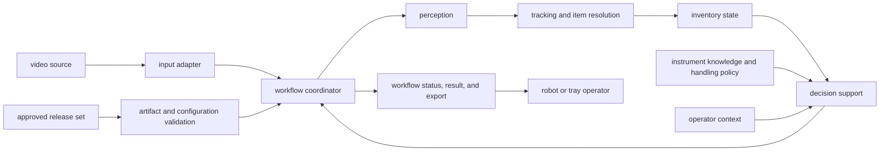
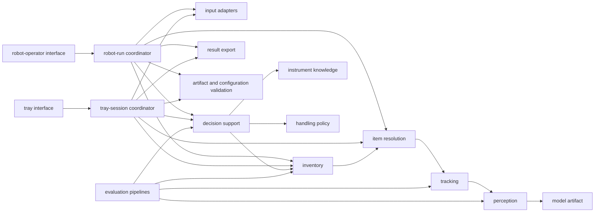

# architecture overview

> defines the target system structure, component responsibilities, workflow orchestration, and deployment shape.

## A. system structure

SURGINT uses one shared processing core with separate coordinators for continuous robot operation and tray inventory. The core owns perception, tracking, item resolution, inventory, instrument knowledge, and handling policy. Each coordinator applies the timing and lifecycle required by its workflow.

## B. dependency graph

an arrow means the component on the left depends on the component on the right. Operator interfaces do not bypass workflow coordinators to mutate core state.

## C. component responsibilities

| component | responsibility | does not own |
|---|---|---|
| workflow coordinator | owns one robot run or tray session, its state transitions, timing, and output delivery. | model inference, domain rules, or robot actuation. |
| input adapter | converts a live camera or recorded video into ordered frames with source timing and identity. | detection, tracking, or workflow decisions. |
| perception | transforms frames into classified instrument detections with confidence and artifact provenance. | physical identity, inventory, or handling guidance. |
| tracking and item resolution | preserves physical identity across frames and determines when an item has enough evidence to be resolved. | handling policy or operator presentation. |
| inventory | records resolved physical items exactly once and exposes current or finalized inventory state. | classification or policy evaluation. |
| instrument knowledge | maps supported perception labels to versioned instrument facts. | workflow state or handling decisions. |
| decision support | combines a resolved item, operator context, instrument facts, and handling policy into guidance or `Needs review`. | robot motion or actuation. |
| operator interface and API | exposes workflow controls, current state, results, failures, and exports. | domain inference or hidden mutation of workflow state. |
| artifact and configuration loader | validates and supplies a compatible release set to the runtime. | training, promotion, or runtime decisions. |

## D. workflow composition

### D.1 continuous robot operation

the robot coordinator processes an ordered live stream, resolves physical items during the run, requests handling guidance immediately, and publishes one result and one inventory update per resolved item. The run remains open until the robot operator stops it or a critical failure occurs.

### D.2 instrument-tray inventory

the tray coordinator collects live or recorded observations while showing synchronized perception results. When capture ends, it validates context, freezes the inventory, resolves handling guidance, and exposes one finalized result.

## E. deployment shape

| profile | runtime location | interaction | output timing |
|---|---|---|---|
| robot edge | selected robot edge hardware | local robot-operator interface | per resolved item during the run |
| tray service | Hugging Face Space GPU or local workstation GPU | browser interface backed by an API | perception during capture; inventory and decisions after finalization |

both profiles use the same core contracts and versioned artifacts. Packaging and performance tuning may differ by profile.

## F. architecture boundary

SURGINT ends at perception, inventory, and handling guidance. Robot motion, actuation, motion safety, and execution remain outside the system.
