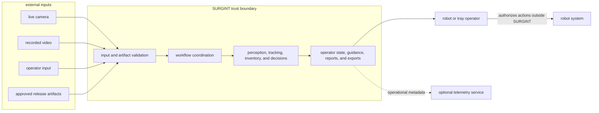

# system context

> defines the people, external systems, data sources, and trust boundaries around SURGINT.

## A. context

## B. people and external systems

| actor or system | relationship to SURGINT |
|---|---|
| robot operator | starts and stops a run, supervises state, receives per-item guidance, reviews unresolved items, and authorizes robot actions outside SURGINT. |
| tray operator or evaluator | captures a tray, supplies context, finalizes inventory, reviews outcomes, and exports results. |
| researcher or engineer | prepares data and artifacts, evaluates releases, and inspects technical evidence and limitations. |
| live camera | supplies an ordered frame stream and source timing. Camera control beyond basic capture is outside SURGINT. |
| recorded video | supplies a bounded tray input with source timing and format metadata. |
| robot system | performs motion and actuation under its own operational and safety controls. It does not receive execution commands from SURGINT. |
| artifact source | supplies approved model, instrument-knowledge, policy, schema, and configuration versions. |
| deployment platform | provides compute, storage needed by the active run, networking, and process supervision for the robot-edge or tray-service profile. |
| telemetry service | optionally receives non-blocking operational metrics without raw media, credentials, or identifying information. |

## C. system boundary

inside SURGINT are media intake, perception, tracking, item resolution, inventory state, instrument knowledge, handling policy, workflow coordination, operator presentation, and result export.

outside SURGINT are robot actuation, motion planning, motion safety, clinical decisions, sterility assessment, facility accountability, external identity systems, and long-term media retention.

## D. trust boundaries

| boundary | required treatment |
|---|---|
| media input | validate type, size, decode behavior, ordering, and configured limits before or during processing. |
| operator input | validate workflow transitions, context values, and item overrides before they affect results. |
| artifact loading | verify schema compatibility, required metadata, version identity, and integrity before a workflow starts. |
| robot-edge or tray-service process boundary | expose only the interfaces required by the active deployment profile and keep workflow state isolated. |
| public network boundary | add authentication, encrypted transport, request limits, and session controls before access by untrusted clients. |
| telemetry boundary | send operational metadata only and keep primary workflow success independent of telemetry delivery. |
