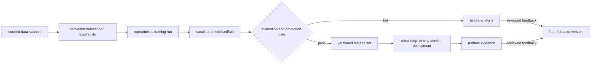

# data and model lifecycle

> defines how data, training runs, evaluations, model artifacts, and complete release sets become eligible for runtime use.

## A. lifecycle



## B. dataset version

a dataset version shall identify its source, annotation format, class list, annotation digests, split membership, preparation configuration, and known limitations. Published evaluation splits are immutable; corrected data becomes a new version.

training, validation, and evaluation separation shall be preserved. Runtime or evaluation failures may become candidate data only after review, annotation, and assignment to a new dataset version.

## C. training run

a training run shall record the dataset version, configuration, code version, base model or initialization, dependency versions, random seeds where applicable, hardware, logs, and produced checkpoints.

training tracking services may mirror this information, but the reproducible run record shall not depend on an external dashboard remaining available.

## D. candidate model artifact

a deployable model candidate shall be immutable and contain or reference:

- model weights and integrity digest;
- model and manifest schema versions;
- ordered class labels;
- required preprocessing parameters;
- training-run and dataset provenance;
- supported runtime and dependency constraints.

## E. evaluation and promotion

a candidate may be promoted only when:

1. its manifest and files pass integrity and compatibility validation;
2. perception results meet the approved class-level acceptance profile;
3. stateful tracking and inventory results meet the approved sequence-level acceptance profile;
4. its label map is compatible with instrument knowledge and handling policy;
5. timing and resource behavior are measured on each claimed deployment profile;
6. known limitations and failure analysis are recorded;
7. promotion is explicit and identifies the evidence used.

```text
algorithm promote_candidate(candidate, release_definition, acceptance_profile):
    validate_manifest_and_integrity(candidate)
    verify_dataset_and_training_provenance(candidate)
    verify_label_knowledge_policy_compatibility(candidate)

    perception_evidence := evaluate_perception(candidate)
    stateful_evidence := evaluate_tracking_and_inventory(candidate)
    deployment_evidence := evaluate_claimed_runtime_profiles(candidate)

    evidence := combine(
        perception_evidence,
        stateful_evidence,
        deployment_evidence
    )

    if any_required_gate_fails(evidence, acceptance_profile):
        record_failure_analysis(candidate, evidence)
        reject(candidate)
        return REJECTED

    require_explicit_approval(candidate, evidence)
    return create_immutable_release_set(
        release_definition,
        candidate,
        evidence
    )
```

## F. release set and deployment

a runtime release set pins compatible versions of application code, model artifact, instrument knowledge, handling policy, configuration, and interface schemas. Deployments shall select a named release set rather than independently selecting `latest` components.

startup shall validate the complete release set before accepting work. Rollback means redeploying a previously accepted release set, not mixing old and new components.

## G. runtime evidence and feedback

runtime evaluation records shall identify the release set, deployment profile, input conditions, timing, outcomes, and failures. Raw media is retained only when an approved data process defines its purpose, access, and retention.

runtime evidence may inform a new dataset or model candidate, but no production or evaluation data shall trigger automatic training or promotion.
